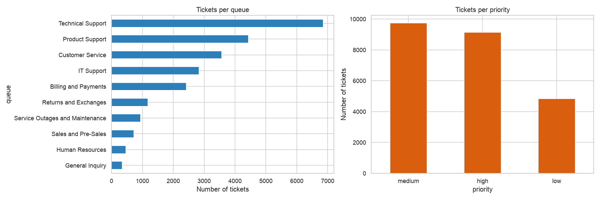
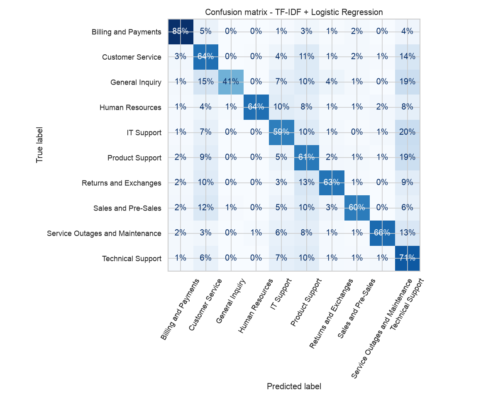
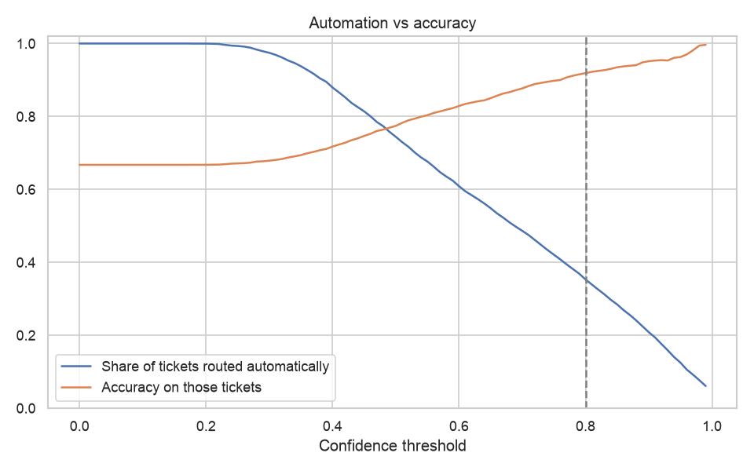

# Smart Support-Ticket Triage with NLP

Machine learning models that read a support ticket and decide **which team should handle it** and **how urgent it is**. Confident predictions are routed automatically; uncertain ones go to a human.

## Why it matters

Manual ticket triage is slow and inconsistent. Every misrouted ticket bounces between teams and delays the fix. Automating the confident cases frees agents to work on real problems.

## Results

Trained on 23,744 English tickets across 10 queues; scores are on a held-out 20% test set (4,749 tickets).

| Model                                                          | Accuracy  | Macro F1  |
| -------------------------------------------------------------- | --------- | --------- |
| Baseline (always the biggest queue)                            | 28.9%     | 0.045     |
| **TF-IDF + Logistic Regression (best)**                        | **66.7%** | **0.663** |
| Sentence embeddings (MiniLM transformer) + Logistic Regression | 29.5%     | 0.282     |

- **Confidence-based routing:** 35.3% of tickets routed automatically at 91.9% accuracy (confidence threshold 0.80, chosen on a validation set and checked on the test set); the rest go to a human.
- **Business impact:** about 176 hours of manual triage saved per month at 10,000 tickets (3 minutes each).
- **Urgent tickets:** the priority model catches 72.2% of high-priority tickets (69.0% overall priority accuracy).





## Approach

1. **Data:** [Customer Support Tickets](https://huggingface.co/datasets/Tobi-Bueck/customer-support-tickets) by Tobias Bueck (synthetic support emails with queue and priority labels). English tickets only. Licensed [CC BY-NC 4.0](https://creativecommons.org/licenses/by-nc/4.0/); the data is downloaded at run time and not included in this repo.
2. **Cleaning:** joined subject and body, and dropped labels with fewer than 30 examples (none were that rare). Of 28,261 English tickets, 4,512 were exact duplicates (the dataset lists them twice) and 5 were nearly empty, leaving 23,744.
3. **EDA:** queue and priority distributions, ticket length, most distinctive words per queue.
4. **Models:** a majority-class baseline, TF-IDF (words and two-word phrases) with Logistic Regression (regularisation `C` chosen by 3-fold cross-validation on the training set), and transformer sentence embeddings with Logistic Regression. Balanced class weights so small queues count.
5. **Evaluation:** held-out test set (20%), accuracy, macro F1, per-queue precision and recall, confusion matrix.
6. **Deployment logic:** a confidence threshold decides between automatic routing and human review. The threshold is chosen on a validation set, so the test set is used only for the final check.

## Run it yourself (VS Code)

1. Install **Python 3.11+** (built and tested with Python 3.14) and the **Python** and **Jupyter** extensions in VS Code.
2. Open this folder: **File → Open Folder → ticket-classifier**.
3. Open the terminal (**Terminal → New Terminal**) and run:
   ```bash
   python3 -m venv .venv
   source .venv/bin/activate
   pip install -r requirements.txt
   ```
4. Open `ticket_classifier.ipynb`, click **Select Kernel** (top right) → **.venv**, then **Run All**.

The first run downloads the data (about 50 MB) and the transformer model (about 90 MB). The whole notebook takes about 5–10 minutes on a laptop.

## Tools

Python, pandas, scikit-learn, sentence-transformers (Hugging Face), matplotlib, seaborn.

## Next steps

- Fine-tune a transformer directly on the tickets.
- Add product and customer fields as features.
- Retrain monthly and monitor accuracy as new issue types appear.
